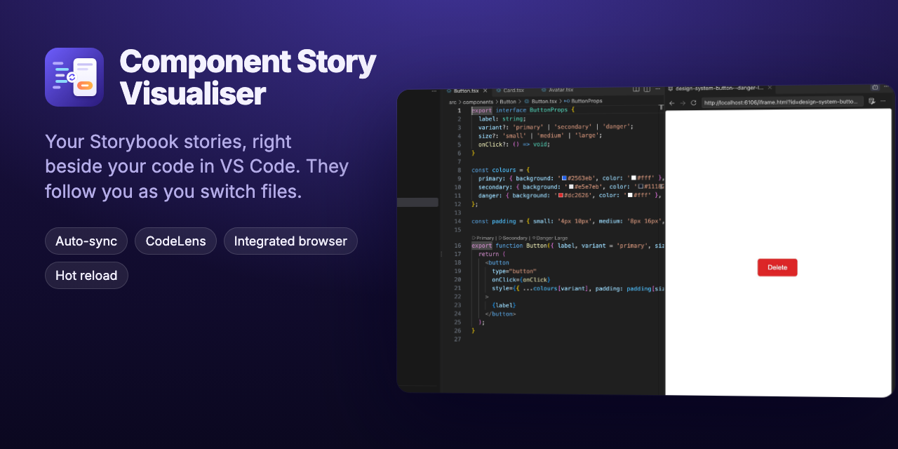
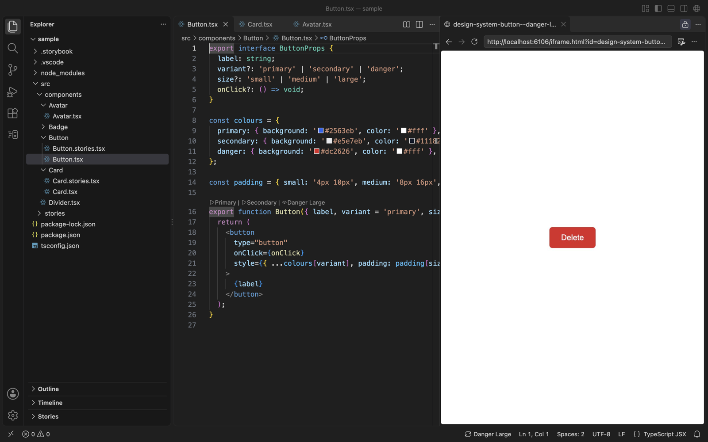
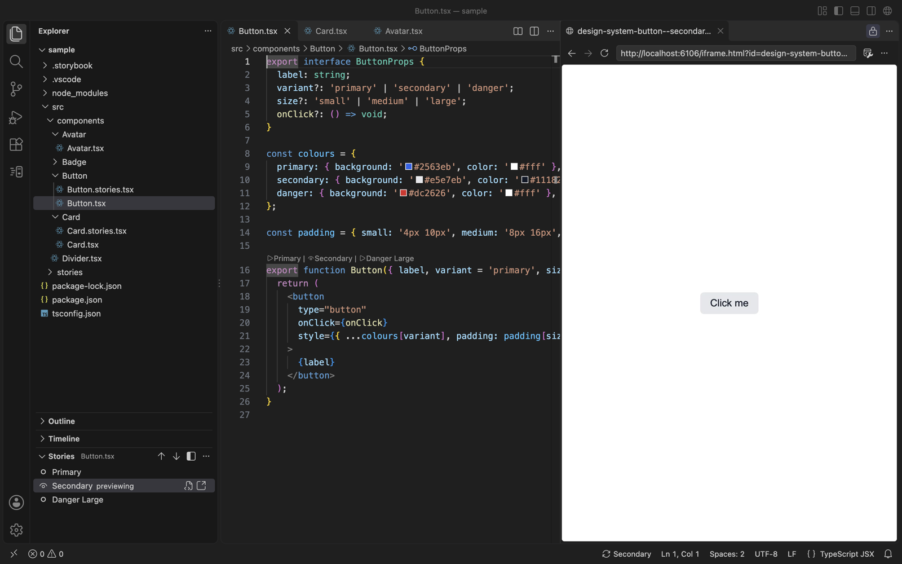
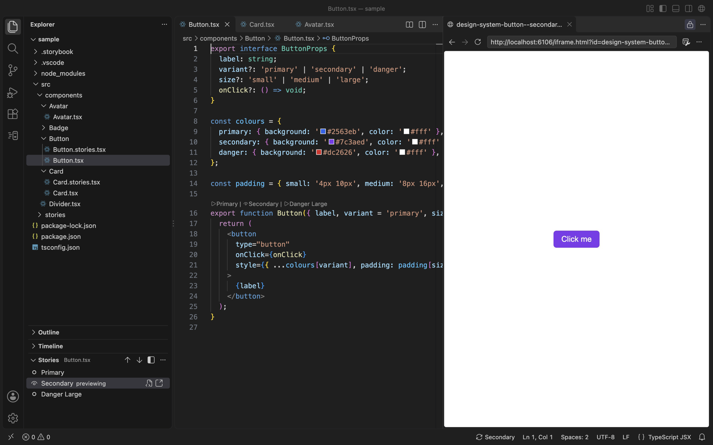
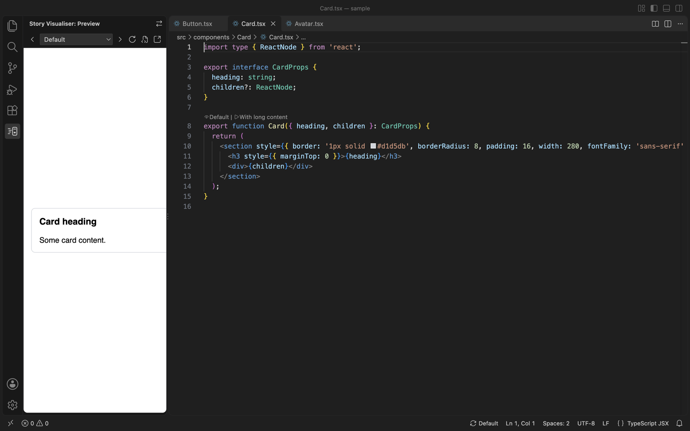

<p align="center">
  
</p>

<p align="center">
  <a href="LICENSE"></a>
  
  
</p>

**Component Story Visualiser** puts the Storybook story for the component you're editing right beside your code, and keeps it in sync as you move between files. No more alt-tabbing to a browser and clicking through the Storybook sidebar to find the thing you're working on.

<p align="center">
  
  <br>
  <sub><a href="images/demo.mp4">Watch in full quality (MP4)</a></sub>
</p>

## Features

- **Opens automatically.** Open `Button.tsx` and its story opens in the next editor group, rendered in VS Code's integrated browser. Your cursor stays in your code.
- **Follows you.** Switch to `Card.tsx` and the same tab swaps to Card's story. Files without a story leave the preview alone.
- **Every story, one click away.** A CodeLens row above your component lists its stories (`▷ Primary | 👁 Secondary | ▷ Danger Large`). Click one to preview it. The eye marks what's showing.
- **Stories view.** A list of the active component's stories in the Explorer, like the Outline view for Storybook.
- **Cursor sync in stories files.** Put your cursor in `export const DangerLarge` and the preview shows that story.
- **Live updates.** Edits hot-reload through Storybook's HMR, with no refresh and no lost place.
- **Put it where you like.** Use the integrated browser (with DevTools), a webview beside your code, or the Story view in the Primary Side Bar, which you can move to the Secondary Side Bar or the Panel.
- **Plays nicely with your own browser tabs.** The extension only ever reuses tabs it opened itself, so the app you're testing in the integrated browser is never touched.
- **Starts Storybook for you.** If Storybook isn't running, the extension offers to start it using your project's own script and package manager.

<table>
  <tr>
    <td width="50%"></td>
    <td width="50%"></td>
  </tr>
  <tr>
    <td align="center"><sub>CodeLens: click a story to preview it</sub></td>
    <td align="center"><sub>Stories view in the Explorer</sub></td>
  </tr>
  <tr>
    <td width="50%"></td>
    <td width="50%"></td>
  </tr>
  <tr>
    <td align="center"><sub>Edits hot-reload instantly</sub></td>
    <td align="center"><sub>Or keep the preview in the side bar</sub></td>
  </tr>
</table>

## Getting started

1. **Install the extension.** Download the latest `.vsix` from [Releases](https://github.com/edrickleong/vscode-component-story-visualiser/releases), then run:

   ```bash
   code --install-extension component-story-visualiser-*.vsix
   ```

   Or in VS Code, open the Extensions view (`⇧⌘X` / `Ctrl+Shift+X`), then choose **⋯ → Install from VSIX…**.

2. **Open a project that uses Storybook** (it has a `.storybook` folder).
3. **Start Storybook** as you normally do, or let the extension start it when prompted.
4. **Open a component.** Its story appears beside it.

If your Storybook doesn't run on `http://localhost:6006`, set `storyVisualiser.storybookUrl`, for example in `.vscode/settings.json`.

## Using it

| To… | Do this |
| --- | --- |
| Preview a component's story | Open the component, or click **Show Story** (📖) in the editor title bar |
| Switch story | Click a CodeLens above the component, a row in the **Stories** view, or the status bar item |
| Step through stories | `Ctrl+Alt+]` / `Ctrl+Alt+[` |
| Pick a story in a stories file | Move your cursor into its `export` |
| See the full Storybook UI (sidebar, controls, addons) | **Story Visualiser: Toggle Full Storybook UI** |
| Jump to a story's source | The go-to-file button in the Stories view or the preview toolbar |
| Pause automatic sync | **Story Visualiser: Toggle Automatic Story Sync** |

Closing the preview pauses auto-open for that component until you switch to another one or click **Show Story**.

### Where the preview appears

Set `storyVisualiser.previewTarget`:

| Value | Where | Notes |
| --- | --- | --- |
| `auto` *(default)* | The integrated browser if your VS Code has it, otherwise `webview` | |
| `integratedBrowser` | VS Code's integrated browser, beside your code | A real Chromium tab with DevTools. Opens in VS Code's browser side group, a locked group next to your code. |
| `webview` | A webview editor beside your code | Toolbar with a story picker, previous/next, reload, go to source and open externally. |
| `sidebar` | The **Story view** in the Primary Side Bar | Adds no editor groups. Use **Move Story Preview…** (⇄ in the view title) to put it in the Secondary Side Bar or the Panel. It only reveals itself the first time; after that it updates in the background, so it never takes the side bar back from the Explorer. |
| `simpleBrowser` | The built-in Simple Browser | |
| `external` | Your default browser | Opens only when you click **Show Story**. |

## How stories are found

1. **Storybook's own index** (`/index.json`). Recent Storybook versions record which component each story renders (`componentPath`), which gives an exact match.
2. **Neighbouring files:** `Button.stories.tsx`, `Button.story.tsx`, `__stories__/` and `stories/` folders. An `index.tsx` matches `<Folder>.stories.*`.
3. **Stories anywhere else** whose default export's `component` is imported from the file. For example, `src/stories/UserAvatar.stories.tsx` is matched to `components/Avatar/Avatar.tsx`.

If Storybook isn't running, story IDs are worked out from source, using the explicit `title` or `id`, or Storybook's automatic title from the `stories` globs in `.storybook/main.*`.

Tested with Storybook 10 and React (`.tsx`/`.jsx`). Any Storybook that serves `/index.json` (version 7 and later) should work. Vue (`.vue`) and Svelte (`.svelte`) components are matched the same way but haven't been tested as thoroughly yet. Reports are welcome.

## Settings

| Setting | Default | Description |
| --- | --- | --- |
| `storyVisualiser.storybookUrl` | `http://localhost:6006` | Address of your Storybook dev server |
| `storyVisualiser.autoSync` | `true` | Open and follow stories automatically as you switch files |
| `storyVisualiser.previewTarget` | `auto` | Where to show stories (see above) |
| `storyVisualiser.viewMode` | `canvas` | `canvas` shows only the story; `storybook` shows the full Storybook UI |
| `storyVisualiser.codeLens` | `true` | Show story CodeLenses above components and story exports |
| `storyVisualiser.componentExtensions` | `.tsx .jsx .vue .svelte .ts .js` | File types treated as components |
| `storyVisualiser.startCommand` | *(detected)* | Command used by **Start Storybook** (e.g. `pnpm storybook`) |

## Troubleshooting

- **Nothing opens.** Check the status bar: *Storybook offline* means the extension can't reach `storyVisualiser.storybookUrl`. Click it to start Storybook. For details, open **Output → Story Visualiser**.
- **The integrated browser says "Paused due to Notification".** This is VS Code pausing the browser while a notification covers it. Dismiss the notification.
- **Wrong story or no story found.** Run **Story Visualiser: Refresh Story Index**. If your stories live somewhere unusual, make sure their default export sets `component`.

## Development

```bash
npm install
(cd sample && npm install && npm run storybook)   # sample Storybook on http://localhost:6106
```

Press **F5** (*Run Extension (sample project)*) to try your changes. The sample uses port 6106 so it never clashes with a Storybook you already run on 6006.

| Command | What it does |
| --- | --- |
| `npm run test:unit` | Fast tests for story parsing, IDs, auto-titles and file matching. Includes a check that source-derived IDs match Storybook's real index. |
| `npm run test:integration` | Runs inside VS Code via `@vscode/test-electron`: auto-open, tab reuse, cursor sync, CodeLens, the Stories and Story views, coexisting with your own browser tabs, and offline fallback. |
| `npm run test:e2e` | Launches VS Code with a debugging port and drives the real UI with [agent-browser](https://github.com/vercel-labs/agent-browser): clicks, keyboard and screenshots. It checks inside the integrated browser that the right story actually rendered. |
| `npm run package` | Builds the `.vsix` |

Integration and e2e tests use your installed VS Code (set `VSCODE_PATH` to override).

### Marketing assets

The icon, banner, screenshots and demo video are generated, not hand-made. [`marketing/capture.mjs`](marketing/capture.mjs) installs the packaged `.vsix` into a clean VS Code profile, drives each feature and takes Retina screenshots. A [Remotion](https://www.remotion.dev) project then turns them into the video and images:

```bash
npm run package && cd marketing && npm install && npm run build
```

## Contributing

Issues and pull requests are welcome. Please run `npm test` before opening a PR, and include a failing test with bug fixes where you can.

## Licence

[MIT](LICENSE) © Edrick Leong
